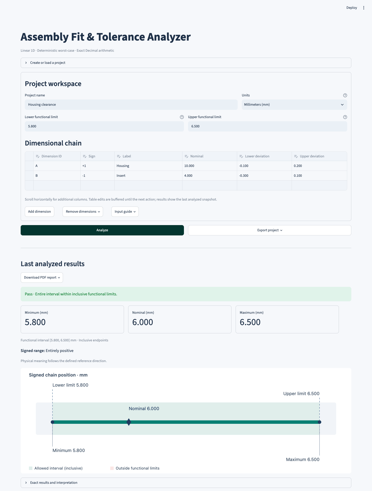

# Assembly Fit & Tolerance Analyzer

A local engineering application for exact, deterministic worst-case tolerance
analysis of linear one-dimensional dimensional chains.

Calculate a signed assembly result and its minimum-to-maximum envelope from
component dimensions and tolerances. Inspect each contribution before deciding
whether the complete interval meets a justified functional requirement.

## Capabilities

- Exact Python `Decimal` arithmetic with immutable validated inputs.
- Positive/negative contributions; symmetric, asymmetric, unilateral and zero
  tolerances. Negative calculated results are preserved.
- Optional inclusive functional limits. Analysis-only projects receive **no
  Pass/Fail verdict** when limits are absent.
- Physical endpoints, signed contributions, trace totals and interval visualization.
- Streamlit workspace with text-based dimensional inputs and explicit analysis.
- UTF-8 JSON upload/download: schema 2, Decimal strings, ordered contributions
  and backward-compatible reading of version-1 projects.
- Engineering PDFs with exact values, traces, project fingerprints and explicit
  unassessed status when functional limits are absent.

## Scope and limitations

The model assumes linear additive dimensions, consistent units (`mm` or `in`),
fixed contribution signs and independently attainable endpoints. Physical lengths
must be nonnegative; signed chain results may be negative. Units are never
converted automatically. Engineering inputs reject binary floats and booleans.

Worst-case bounds are deterministic limits, **not statistical probabilities or
predicted yield**. There is no RSS, Monte Carlo, GD&T, thermal simulation,
bearing-life calculation or CAD integration. The software does not establish
physical suitability, production readiness or ISO/ASME compliance. Engineers
must justify the chain, dependencies, operating conditions and functional limits.

See the [engineering contract](docs/engineering-spec.md),
[resource budgets](docs/resource-limits.md) and
[PDF limitations](docs/pdf-reporting.md). JSON is limited to 8 MiB and 1,000
dimensions; PDFs to 250 dimensions and 100,000 dynamic text characters.
Arithmetic precision guards are separate from these application budgets.

## Screenshot

Actual local Streamlit workspace using the housing/insert worked example:



[Capture details](docs/screenshots/README.md) identify the environment and data.

## Install and launch

Requires Python 3.11 or newer. **Python 3.14 is the CI baseline**; local release
verification also passed on Python 3.11.17 with compatible dependencies. Other
interpreter/operating-system combinations are not all tested.
Run from a downloaded or cloned repository on macOS or Linux:

```sh
python3 -m venv .venv
source .venv/bin/activate
python -m pip install --upgrade pip
python -m pip install -e '.[ui]'
python -m streamlit run streamlit_app.py --server.address 127.0.0.1
```

On Windows PowerShell, activate with `.venv\Scripts\Activate.ps1`.
Open the printed localhost URL; stop with Ctrl+C. The launcher and theme are
repository files, so run from the repository root. The wheel provides the Python
package, rather than a standalone application or bundled UI launcher.
For API-only use, install `.`; add `.[reports]` for PDFs. Core calculations and
persistence have no runtime dependencies.

Select **Use worked example**, confirm **Replace workspace**, then **Analyze**.
Enter numeric values as text; dimension ID and sign appear first, with horizontal
scrolling for other columns. Commit active cells before acting. Leave both
functional limits blank for analysis only, or supply both for assessment.

Upload JSON through **Create or load a project** and confirm replacement.
Download validated inputs through **Export project** and reports through
**Download PDF report** after analysis. Edits invalidate previous results and
reports; rerun Analyze. Browser downloads do not require server filesystem paths.
Drafts survive ordinary reruns but are not disk autosaves: download work before
refreshing, disconnecting or stopping the server.

## Reproducible calculation

Housing `10.000 −0.100/+0.200 mm` minus insert `4.000 −0.300/+0.100 mm`:

```python
from assembly_fit_analyzer.calculations import analyze_project
from assembly_fit_analyzer.domain import (
    AcceptanceLimits,
    AnalysisProject,
    DimensionContribution,
)

project = AnalysisProject(
    name="Housing clearance",
    unit="mm",
    contributions=[
        DimensionContribution("H", "Housing", "10.000", "-0.100", "0.200", 1),
        DimensionContribution("I", "Insert", "4.000", "-0.300", "0.100", -1),
    ],
    acceptance_limits=AcceptanceLimits("5.800", "6.500"),
)
result = analyze_project(project)
print(result.minimum, result.nominal, result.maximum, result.passes)
# 5.800 6.000 6.500 True
```

For positive contributions, the minimum uses the physical lower endpoint; for
negative contributions it subtracts the upper endpoint. Maximum selection is
reversed. Boundary equality is accepted without rounding or hidden tolerances.
Omit `acceptance_limits` for analysis only: `result.passes` is then `None`.

## Projects, reports and engineering example

```python
from pathlib import Path

from assembly_fit_analyzer.persistence import load_project, save_project
from assembly_fit_analyzer.reporting import generate_pdf_report

save_project(project, "housing-clearance.json")
restored = load_project("housing-clearance.json")
Path("housing-clearance.pdf").write_bytes(generate_pdf_report(result))
```

JSON stores validated inputs, not cached results. New saves use schema 2; null
limits preserve analysis-only status. Version 1 remains readable with its
original complete limits. Local saves use atomic replacement where supported;
malformed, ambiguous and over-budget documents are rejected. PDFs use validated
analysis snapshots. Identical inputs and software versions produce identical
bytes unless an explicit issue time is supplied.

[Case Study 01 — Bearing Axial Clearance](docs/case-studies/01-bearing-axial-clearance/README.md)
includes a schematic, manufacturer-source qualifications, an independent
worksheet, four analysis-only JSON projects and four PDF reports. It is a
**preliminary engineering example**, not a validated bearing-system design.

## Development and verification

For the pinned Python 3.14 macOS/Linux release environment:

```sh
python -m pip install -r requirements/ci.txt
python -m pip install --no-build-isolation -c requirements/ci.txt -e '.[dev,ui,browser]'
python -m pip check
python -m ruff check .
python -m ruff format --check .
python -m pytest --ignore=tests/test_browser_safety.py
python docs/case-studies/01-bearing-axial-clearance/verify_calculations.py
python tools/verify_case_study_artifacts.py
python -m pip wheel --no-build-isolation --no-deps --wheel-dir dist .
```

The pins are an environment snapshot, not a universal cross-platform lock.
For development on other supported Python versions, use
`python -m pip install -e '.[dev,ui,browser]'` instead. Pin updates require a
new verification run. See [release preparation](docs/release-v1.0.md).

The six Chrome tests need Google Chrome, Playwright and a running app. On Linux,
`python -m playwright install --with-deps chrome` installs browser/system
packages. Start the app in one terminal, then run the complete suite in another:

```sh
python -m streamlit run streamlit_app.py --server.address 127.0.0.1 --server.port 8507
```

```sh
AFA_BROWSER_URL=http://127.0.0.1:8507 python -m pytest
```

On PowerShell, set `$env:AFA_BROWSER_URL = "http://127.0.0.1:8507"` before pytest.
Plain `python -m pytest` skips six browser tests when the URL is unset.
CI separates non-browser tests/build and all six Chrome tests into explicit
jobs. No private credentials or application services are required. Chrome and
runner OS packages are externally maintained, so their versions can vary.
See the [manual acceptance checklist](docs/manual-acceptance.md).

## Repository and release status

`src/assembly_fit_analyzer/` separates domain, validation, calculations,
persistence, reporting and UI. `tests/` covers these boundaries; `docs/` holds
engineering specifications and the case study. `tools/` contains release
verification helpers. No standalone calculation CLI is provided.

See the [release checklist and suggested notes](docs/release-v1.0.md).
Licensed under the **MIT License**; copyright (c) 2026 Samahara Aguilar.
See [LICENSE](LICENSE) and the
[final pre-publication review](docs/pre-publication-review.md) for publication
gates and proposed commands. The case study retains its manufacturer references;
the project's license does not relicense third-party material.
