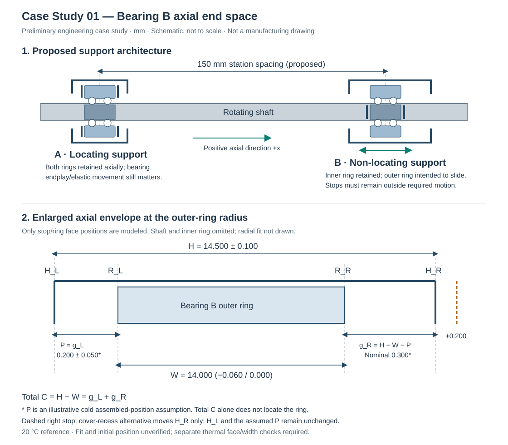

# Case Study 01 — Bearing Axial Clearance

**Preliminary engineering case study — conditional dimensional model, not a
validated production-ready bearing assembly.**
Research and numerical review: 19 October 2026. Units: mm unless stated otherwise.

This study examines axial clearance in a locating / non-locating bearing
assembly. The original and cover-recess designs are reproducible numerical
examples; neither is a verified bearing-system design.

## 1. Engineering problem and decision

A shaft has a locating bearing A and a non-locating bearing B, with a proposed
150 mm station separation. At B, a proposed housing envelope is 14.50 ± 0.10 mm
long around a nominally 14 mm wide bearing. Does the dimensional envelope leave
space for assembly and relative axial movement? Would recessing one end cover
provide a useful change?

The preliminary arithmetic is reproducible, but **total end space does not
establish available travel in either direction**. Positive calculated space also
does not establish that a loaded bearing ring will slide. This study separates
those questions and leaves functional Pass/Fail unassigned.

The smallest defensible architecture change is to retain a 6204 at B **only if**
its outer ring has a suitable sliding seat and remains clear of axial obstructions
through the complete required travel. Define and inspect its cold axial position.
Do not treat two close end stops as a second axial locating support. If the load
conditions require an interference fit on both rings, use an internally
displacing bearing arrangement instead. These are conditional recommendations;
neither configuration is approved here.

## 2. Assembly architecture and feasibility

SKF describes both ring-on-seat sliding and internal bearing displacement as
non-locating solutions; deep-groove ball bearings can use the first approach
([S1, pp. 70–71](#sources)). The proposed realization is:

| Location | Inner ring | Outer ring | Axial role |
| --- | --- | --- | --- |
| A, locating | Retained in both directions by shaft shoulder and suitable retaining hardware | Retained in both directions by housing shoulder and cover | Establishes shaft axial location, subject to bearing endplay and elastic displacement |
| B, non-locating, 6204 | Retained on shaft; follows shaft displacement | Slides axially on a continuous cylindrical housing seat | Radial support; does not intentionally establish a second shaft axial datum |

This is a proposed assembly architecture, not a manufacturer mounting drawing.
Retaining hardware, shoulders, seating lengths, radii and bearing abutment
diameters require detail design. End features must clear the inner ring, cage,
and any seals; they must not clamp the moving outer ring. Mounting forces should
act on the ring being fitted, without using the rolling contacts to press-fit
the other ring. The locating bearing is not an infinitely rigid, zero-endplay
datum, and the B inner and outer ring faces need not be axially flush.

### Is a 6204 defensible at B?

**Yes, conditionally as a bearing type; no complete application selection is
established.** The illustrative loading assumption is a rotating shaft with a
radial load direction fixed relative to the stationary housing. This gives a
rotating load relative to the inner ring and a stationary load relative to the
outer ring. SKF's maintenance guidance distinguishes these conditions when
selecting tight versus loose seats ([S2, p. 32](#sources)). A stationary outer
ring alone does not establish a stationary load on it: imbalance, rotating load,
shock, or indeterminate loading can invalidate this assumption.

No numerical shaft/housing fit is selected. A nominal bore designation alone
cannot guarantee sliding at temperature. Check actual ring and seat tolerances,
radial loading, ring/housing temperatures, bore form, finish, alignment, seat
support length, lubrication and corrosion protection. SKF discusses thermal
restriction of a floating seat and the need to leave axial movement unobstructed
([S3, p. 55](#sources)). Grease or a clearance fit does not eliminate sliding
friction. Retaining compound, a clamp, a burr, contamination or fretting can
prevent movement. SKF also documents sliding resistance, induced thrust and
seat wear in conventional floating-ring arrangements ([S4](#sources)). No
friction coefficient, sliding force, wear rate or life is calculated here.

### Why the short pocket needs qualification

For this study, the pocket means the distance between two **assembled, rigid,
non-contact outer-ring stop planes**. It is not the length of a clamping recess.
Both stops must stay outside the required normal-motion envelope. Full radial
seat engagement must remain available throughout that envelope. No drawing or
operating specification yet proves those conditions for the 14.50 mm proposal.

Two close stops can inadvertently convert B into a second axial constraint.
Furthermore, a ring near the right stop can have little positive-direction
travel even when the sum of its two end gaps is generous. Retaining a finite
envelope for calculation is useful; declaring the bearing free to float from
that calculation alone is misleading.

### Internally displacing cylindrical roller option

SKF's **NU 204 ECP** is a candidate with the same catalogue boundary dimensions
20 × 47 × 14 mm ([S1, p. 516](#sources); [S7](#sources)). NU construction permits
relative axial displacement internally, so both rings can be located on their
respective components without relying on outer-seat sliding ([S1, pp. 71, 496](#sources)).
This is a more defensible starting point when both seats need interference fits.
It is not an automatic replacement: verify minimum load, speed, lubrication,
misalignment, mounting abutments, internal displacement allowance and initial
ring offset. Do not transfer the 6204 width tolerance or equate `H − B` with NU
internal travel. That alternative would need a different displacement check.
No cost or bearing-life improvement is asserted. The quantitative alternative
below instead keeps the 6204 and changes only the right stop position.

## 3. Verified data, proposals and assumptions

| Input or condition | Value/status | Evidence or qualification |
| --- | --- | --- |
| Selected catalogue execution at B | **SKF 6204**, open, no suffix, SKF Explorer | S1 p. 270: the designation is blue; the legend identifies blue designations as Explorer. Do not substitute 6204 ETN9, stainless, sealed, special or unspecified-brand variants without rechecking. |
| Boundary dimensions | d = 20; D = 47; B = 14 | Manufacturer catalogue S1 p. 270; current SKF marketplace nominal dimensions agree, S5. |
| Dimensional accuracy | P6 with special tighter width tolerance | S1 p. 250, Explorer exception; corroborated by S6. P6 alone does not establish the special width limit. |
| Width deviation used | lower −0.060; upper 0.000 | S1 p. 250 applies the Explorer exception for D ≤ 110. S1 p. 39 distinguishes outer-ring width C from inner-ring width B; the model uses the **outer-ring face-to-face width**, denoted W here. |
| Procurement/current drawing | **Unresolved** | No supplier drawing, part certificate or purchased bearing inspected. Catalogue is October 2018; verify the exact current execution before release. SKF marketplace S5 calls its tolerance group “Special” but does not quantify it. |
| Housing envelope H | 14.50 ± 0.10 | User's proposed design dimension, at 20 °C; no manufacturing drawing or capability evidence. |
| Cold left gap P | 0.20 ± 0.05 | **Additional illustrative assembled-position assumption** for the directional check only; not verified assembly data or a released inspection requirement. |
| Station separation L | 150 | Proposed nominal bearing-midplane spacing; exact shoulder/face paths and spacing tolerances are not defined. |
| Shaft / housing material | Steel / steel | Assumed; grades and temperature-dependent properties unknown. Bearing steel is not evidence of shaft/housing material. |
| Reference / operating temperatures | 20 °C; shaft 80 °C; housing 50 °C | Illustrative uniform temperatures, not measured or approved operating limits. Bearing-ring temperatures unknown. |
| Expansion coefficient | 0.000012 /°C for each component | Simplifying assumption. SKF uses this steel value in an example, S1 p. 851; this does not verify these unspecified steel grades. |
| Loading and mounting | Fixed load direction in housing; free outer-ring seat | Assumed for feasibility; magnitude, speed, duty, fit and seat condition unresolved. |
| Functional acceptance interval | **Not defined** | No justified minimum running end gap, maximum end space, reverse travel, or allowance for nonthermal movements supplied. No application Pass/Fail assigned. |

The old 13.940–14.000 width interval now has **catalogue support for the selected
Explorer execution**, rather than being an unexplained assumption. This is not
verification of every bearing called 6204. For comparison, the generic P6 width
table gives 0/−0.120 mm for the 20 mm bore band; the Explorer exception is
essential to using 0/−0.060 mm here. Manufacturing
width tolerance, radial internal clearance and axial internal movement are
different quantities.

## 4. Surface, datum and sign definitions

The positive axis runs from A toward B and the outboard/right cover. All
dimensions below are axial plane separations at the reference temperature.
They idealize flat, parallel, coaxial contact geometry; form errors, tilt,
deflection, debris and assembly seating errors are excluded.

| Symbol | Physical definition |
| --- | --- |
| A0 | Housing shoulder plane contacting the inboard face of A's outer ring; the fixed housing reference for a future face-path thermal model. |
| S_A | Shaft shoulder plane contacting the inboard face of A's inner ring. Its position relative to A0 includes A's internal axial movement and mounting details; it is not a second fixed housing datum. |
| H_L | Inboard housing stop plane facing B's outer ring. Fixed local origin x = 0 for the cold gap model. |
| H_R | Outboard cover/stop plane facing B's outer ring, in its assembled condition. |
| R_L | Inboard axial face of B's **outer ring**, away from edge chamfers. |
| R_R | Outboard axial face of that same outer ring. |
| H | x(H_R) − x(H_L), stop-plane separation. A direct assembled dimension; no separate gasket/cover stack is silently omitted. |
| W | x(R_R) − x(R_L), physical outer-ring width. Catalogue nominal B is 14; do not measure across inner-ring faces instead. |
| P = g_L | x(R_L) − x(H_L), cold left end gap. It locates the outer ring relative to this pocket, not relative to the shaft alone. |
| g_R | x(H_R) − x(R_R), right end gap. |
| C | H − W = g_L + g_R, **total available axial end space**. It is not shaft endplay or guaranteed directional bearing travel. |



[Editable SVG source](assembly-chain.svg). Diagram is schematic and not to scale;
it is original artwork, not a reproduced manufacturer drawing. In the enlarged
panel, housing stop planes act only at the outer-ring radius. The shaft/inner
ring is omitted to keep the measured surfaces unambiguous.

## 5. Dimensional chains and independent worst-case results

### Chain A — Total axial end space: C = H − W

| ID | Surfaces | Nominal | Lower deviation | Upper deviation | Sign | Why included / source |
| --- | --- | ---: | ---: | ---: | ---: | --- |
| H | H_L → H_R | 14.500 | −0.100 | +0.100 | +1 | Available envelope, proposed housing dimension |
| W | R_L → R_R | 14.000 | −0.060 | 0.000 | −1 | Space occupied by selected outer ring, catalogue basis above |

All table dimensions are in mm. The 20 mm bore and 47 mm outside diameter
identify the radial interfaces; they are not axial chain contributions. The
150 mm station spacing belongs to the separate thermal estimate, not H − W.

The nominal is the reference subtraction, not the midpoint of the asymmetric
worst-case interval:

```text
H limits = [14.400, 14.600]
W limits = [13.940, 14.000]
C_nominal = 14.500 − 14.000 = 0.500
C_minimum = 14.400 − 14.000 = 0.400
C_maximum = 14.600 − 13.940 = 0.660
```

Independent integer-micrometre endpoint enumeration gives:

| H (µm) | W (µm) | H − W (µm) |
| ---: | ---: | ---: |
| 14,400 | 13,940 | 460 |
| 14,400 | 14,000 | 400 |
| 14,600 | 13,940 | 660 |
| 14,600 | 14,000 | 600 |

H is independent housing geometry and W is purchased-part width. Assuming their
limits can occur together is reasonable for this preliminary envelope. No
selective assembly, shared manufacturing dimension or statistical distribution
is assumed. Boundary form/measurement issues still require drawing review.

### Chain B — Conditional cold right-hand gap: g_R = H − W − P

For this **conditional** check, add physical dimension P between H_L and R_L,
nominal 0.200, deviations −0.050/+0.050, sign −1. P's assumed physical limits
are [0.150, 0.250]. It is included because it specifies which part of C is on
the left and therefore unavailable for positive-direction movement.

| Additional ID | Surfaces | Nominal (mm) | Lower deviation | Upper deviation | Sign | Source / role |
| --- | --- | ---: | ---: | ---: | ---: | --- |
| P | H_L → R_L | 0.200 | −0.050 | +0.050 | −1 | Illustrative cold-position assumption; consumes the left-hand portion of total space |

```text
g_R nominal = 14.500 − 14.000 − 0.200 = 0.300
g_R minimum = 14.400 − 14.000 − 0.250 = 0.150
g_R maximum = 14.600 − 13.940 − 0.150 = 0.510
g_L nominal/minimum/maximum = 0.200 / 0.150 / 0.250
```

All eight H/W/P endpoint combinations are geometrically compatible with positive
end gaps. Their independent envelope is conditional on P actually being
achievable across the selected parts. A production model must derive P from the
assembled shoulder/retainer stack, A/B ring offsets and axial freedom, or verify
it by an appropriate assembled measurement. Nominal centering is not guaranteed
by equal bearing widths. Do not add independently calculated g_L/g_R extrema:
both share P with opposite signs, so those extrema cannot occur together. The
identity `g_L + g_R = H − W` holds for each actual assembly.

### Meaning of signed results

- C > 0: some total space exists; the ring can still touch a stop or stick on
  its seat. C = 0: zero total idealized end space. C < 0: the outer-ring width
  exceeds this envelope; rigid assembly is incompatible without deformation or
  changing the architecture.
- g_R > 0: separation at the right stop, geometrically available for motion
  toward +x only if sliding and other constraints permit it. g_R = 0: contact.
  g_R < 0: the assumed ring position overlaps the stop; a real assembly must
  instead move, deform or develop an axial reaction. It is not a prediction of
  actual elastic penetration or a radial interference fit.
- A g_R interval crossing zero would mean possible contact/overlap for some
  permitted combinations, not contact in every assembly. The same interpretation
  applies at the left stop using g_L.

## 6. Thermal displacement: separate supporting analysis

At the proposed station separation, uniform free expansion gives:

```text
ΔL_shaft   = 0.000012 × 150 × (80 − 20) = 0.108 mm
ΔL_housing = 0.000012 × 150 × (50 − 20) = 0.054 mm
δ_span     = ΔL_shaft − ΔL_housing      = +0.054 mm
```

The positive sign means the shaft B station moves farther from A than the
corresponding housing station, under these assumptions. This is a deterministic
scenario estimate, not a verified displacement demand, probability or thermal
simulation. For nonuniform temperature/material paths the appropriate check is
the difference of the two path integrals of thermal strain, with actual anchor
conditions and other displacements included.

The physically relevant gap equations are:

```text
g_L(T) = P_0 + ΔP
g_R(T) = (H_0 + ΔH) − (W_0 + ΔW) − (P_0 + ΔP)
```

ΔP must be the displacement of R_L relative to H_L. The two 150 mm station
lengths do not fully define those face-to-face thermal paths. Bearing A endplay,
B inner/outer relative movement, ring temperatures, local housing/cover growth,
fit friction, mounting offsets and elastic displacement remain unresolved.
In particular, **δ_span is not automatically ΔP**.

A deliberately simplified directional check sets ΔP = +0.054 and ΔH = ΔW = 0.
This freezes local widths only to isolate station-motion allocation; it is not
a complete hot-dimensional model. It gives:

| Conditional quantity | Minimum | Nominal | Maximum |
| --- | ---: | ---: | ---: |
| Left gap P + 0.054 | 0.204 | 0.254 | 0.304 |
| Right gap g_R − 0.054 | 0.096 | 0.246 | 0.456 |

The 0.096 mm remainder is **not a qualified operating margin**. No minimum
running gap or allowance for omitted effects has been established. Local H/W
expansion may matter and has not been assigned convenient cancelling values.
Reverse thermal motion and transients also require checks at the left stop.

Counterexample to a total-space guarantee: take H = 14.500, W = 14.000 and
P = 0.480. C is still 0.500, but g_R is only 0.020. A hypothetical +0.054 ring
movement would produce g_R = −0.034 with frozen local widths. This counterexample
is outside the illustrative P band; it demonstrates why that missing position
information cannot be replaced by comparing 0.054 with C_minimum.

## 7. One quantitative design alternative

**Recess the right cover stop by 0.200 mm**, retaining H_L, the cylindrical seat,
and the same cold P envelope. Proposed H becomes **14.700 ± 0.100 mm**. This is
an assumed design change, not a manufacturing recommendation or approved limit.

| Quantity | Original: minimum / nominal / maximum | Recessed cover: minimum / nominal / maximum |
| --- | --- | --- |
| H | 14.400 / 14.500 / 14.600 | 14.600 / 14.700 / 14.800 |
| Total C = H − W | 0.400 / 0.500 / 0.660 | 0.600 / 0.700 / 0.860 |
| Cold g_R = H − W − P | 0.150 / 0.300 / 0.510 | 0.350 / 0.500 / 0.710 |
| Cold g_L = P | 0.150 / 0.200 / 0.250 | unchanged |
| Conditional g_R − 0.054 | 0.096 / 0.246 / 0.456 | 0.296 / 0.446 / 0.656 |

Each right-gap bound increases by 0.200 because only the right stop moves.
Moving the entire pocket or lengthening it symmetrically would be a different
model: P would change, and the full benefit would not go to the right gap.

This change buys positive-direction geometric space without tightening the
proposed ±0.100 tolerance. It does not reduce the width-driven spread, improve
sliding fit, establish reverse travel, or resolve bearing selection. Check
cover wall thickness, seal/support geometry, available package length, and
retention during handling or abnormal displacement. More space is not inherently
better; a justified required travel and retaining envelope must decide whether
the extra recess is useful. No manufacturing-cost, efficiency or life benefit
is claimed.

## 8. Reproduction, application use and numerical review

From the repository root, after installing the existing project:

```sh
python docs/case-studies/01-bearing-axial-clearance/verify_calculations.py
```

The companion script first enumerates physical endpoints using exact rational
arithmetic (`Fraction`, parsed from text), then compares the five chains with
the existing public `calculate_minimum`, `calculate_nominal` and
`calculate_maximum` APIs. It checks all 26 endpoint combinations, including the
single-dimension left-gap chain, the thermal scenario, the directional
counterexample and the shared-P identity. It uses neither binary floats nor
the engine as its reference oracle.
It does not modify or extend the application.

### Analysis-only JSON and PDF support

The [release corrections](../../release-corrections.md) now support truthful
analysis-only projects. Leave both functional limits blank: the engine returns
`passes=None`, version-2 JSON stores `acceptance_limits: null`, and PDFs state
**Acceptance: Not assessed** with an explicit no-assessment statement. Existing
version-1 projects with complete limits remain readable. Supplying only one
bound is rejected; no expected result is reused as an acceptance threshold.

Earlier review entries describe the former export limitation. It is resolved
in software; the physical inputs and preliminary status are unchanged. The
following projects and reports were generated through the existing production
persistence, analysis and reporting APIs. Every project uses schema version 2,
units `mm` and `acceptance_limits: null`; every report has no acceptance verdict.

| Configuration | Minimum / nominal / maximum (mm) | Project | Engineering report |
| --- | --- | --- | --- |
| Original, Chain A: C = H − W | 0.400 / 0.500 / 0.660 | [JSON](examples/original-chain-a.json) | [PDF](examples/original-chain-a.pdf) |
| Original, Chain B: g_R = H − W − P | 0.150 / 0.300 / 0.510 | [JSON](examples/original-chain-b.json) | [PDF](examples/original-chain-b.pdf) |
| Cover recess, Chain A: C = H − W | 0.600 / 0.700 / 0.860 | [JSON](examples/cover-recess-chain-a.json) | [PDF](examples/cover-recess-chain-a.pdf) |
| Cover recess, Chain B: g_R = H − W − P | 0.350 / 0.500 / 0.710 | [JSON](examples/cover-recess-chain-b.json) | [PDF](examples/cover-recess-chain-b.pdf) |

The alternative adds 0.200 mm to every C and g_R bound by moving only the right
stop; the assumed left gap and interval spreads remain unchanged. This is a
geometric comparison, not a finding that the alternative meets an operating
requirement. Neither total end space nor conditional cold right gap establishes
actual thermal travel, sliding reliability or a validated bearing system.

Project labels identify H as proposed, P as assumed, and W as the qualified
October 2018 open SKF 6204 Explorer catalogue execution, with current procurement
unverified. **Retain this preliminary study alongside all eight artifacts**:
JSON has no notes field for the full source qualification or unresolved assembly
conditions. The reports contain cold-dimensional analysis only; the separate
thermal illustration is not included in their results.

### Reproduce through the public Python APIs

With the environment below installed, run this from the repository root to
reload all four examples, analyze them and regenerate reports in a separate
`case-study-reports/` output directory:

```python
from pathlib import Path

from assembly_fit_analyzer.calculations import analyze_project
from assembly_fit_analyzer.persistence import load_project
from assembly_fit_analyzer.reporting import generate_pdf_report

examples = Path("docs/case-studies/01-bearing-axial-clearance/examples")
output = Path("case-study-reports")
output.mkdir(exist_ok=True)
for path in sorted(examples.glob("*.json")):
    project = load_project(path)
    result = analyze_project(project)
    assert project.acceptance_limits is None
    assert result.passes is None
    print(path.stem, result.minimum, result.nominal, result.maximum, project.unit)
    (output / f"{path.stem}.pdf").write_bytes(generate_pdf_report(result))
```

Inputs and exact numerical results are reproducible independently of PDF byte
encoding. Identical inputs and software versions give deterministic PDF bytes;
different dependency versions can change rendering or encoding. No issue time
was supplied for the bundled reports. See the [review record](review.md) for
artifact validation and test evidence.

### Reproduce in the existing Streamlit workspace

From the repository root, using an activated environment:

```sh
python -m pip install -e '.[dev,ui]'
python -m streamlit run streamlit_app.py
```

Open the displayed localhost URL, then:

For the bundled examples, use **Create or load a project** to upload one of the
four linked JSON files. Confirm replacement only after preserving any work you
want to keep. Check units `mm`, blank functional limits and the H/W/P rows, then
select **Analyze** and compare with the artifact table above. Repeat for the
alternative by loading its JSON and confirming replacement. PDF and JSON export
remain independent; reanalyze after any input edit before generating a report.

To reconstruct an example manually instead:

1. Select **Create or load a project → New project**, and confirm replacement
   only after downloading any existing valid work you want to keep. Set units
   to **Millimeters (mm)**. Use the project names in the table below, each
   prefixed with **Preliminary — Case Study 01**.
2. Enter the rows below as text. Keep H and W for Chain A; add P only for Chain B.
   Use **Add dimension** / **Remove dimensions** as needed. H is `14.500` for the
   original or `14.700` for the cover-recess alternative; its deviations remain
   `-0.100` / `0.100`. Signs are separate from the physical lengths.

   | ID | Descriptive label | Nominal | Lower deviation | Upper deviation | Sign |
   | --- | --- | ---: | ---: | ---: | ---: |
   | H | Housing stop separation H_L to H_R — proposed design | 14.500 or 14.700 | -0.100 | 0.100 | +1 |
   | W | Outer-ring width R_L to R_R — selected 2018 SKF 6204 Explorer catalogue execution | 14.000 | -0.060 | 0.000 | -1 |
   | P | Cold left gap H_L to R_L — illustrative assumption, Chain B only | 0.200 | -0.050 | 0.050 | -1 |

3. **Leave both functional limits blank while they remain unjustified.** Select
   **Analyze**. Verify analysis-only status, no Pass/Fail assessment, and the
   exact results in the table below. Buffered table edits synchronize on this
   action; results shown before it are labeled as the last analyzed snapshot.

   | Project name suffix | Chain | Minimum / nominal / maximum (mm) |
   | --- | --- | --- |
   | Original — Chain A — Total end space | H − W | 0.400 / 0.500 / 0.660 |
   | Original — Chain B — Cold right gap | H − W − P | 0.150 / 0.300 / 0.510 |
   | Cover recess — Chain A — Total end space | H − W | 0.600 / 0.700 / 0.860 |
   | Cover recess — Chain B — Cold right gap | H − W − P | 0.350 / 0.500 / 0.710 |

4. Open **Export project → Download JSON** and check schema version 2 with
   `acceptance_limits: null`. After analysis, open **Download PDF report → Download
   PDF**. Verify **Acceptance: Not assessed**, the no-assessment statement, and
   the correct project, inputs, results and units. Do not add limits merely to
   obtain a verdict. If independently justified requirements become available,
   enter both bounds and reanalyze; assess each quantity against its own limits.
5. Keep this case study alongside any exports: V1 has no notes field carrying
   the complete sources and assumptions. No dimensional result or verdict
   establishes bearing life, load capacity, reliable sliding or production readiness.

This is an independent **numerical-method cross-check and source review within
this work**, not a separate human peer review, manufacturer approval, bearing
life assessment or standards-compliance certification. See the
[review record](review.md) for evidence and publication gates.

## 9. Remaining engineering work before publication as a validated case

1. Obtain the exact current SKF product drawing/tolerance confirmation for the
   selected open 6204 Explorer execution; confirm the outer-face measurement
   definition and any relevant face variation. Record drawing revision/date.
2. Define radial/axial loads, load direction, speed, duty, orientation, lubrication,
   environment and bearing A selection. Check load capacity, internal clearance,
   stiffness, alignment and mounting requirements independently of this tool.
3. Produce a section drawing defining both ring restraints, actual shoulder and
   cover surfaces, seat fit/form/finish, full engagement through travel, and
   assembly hardware. Resolve whether a 6204 sliding seat or an NU arrangement
   is appropriate under the actual load conditions.
4. Replace the assumed P band with a justified shoulder/retainer/axial-offset
   stack or reproducible assembled inspection. Specify the state of A/B axial
   play during inspection. Avoid double counting shared dimensions.
5. Establish actual material grades, temperature profiles and transient extremes;
   define thermal paths from the locating datum to the stop/ring faces. Include
   local widths, axial play, friction and elastic movements in directional checks.
6. Approve functional lower/upper limits, minimum operating end gaps in both
   directions and nonthermal allowances. Assess the alternative against those
   requirements rather than against an invented acceptance interval.
7. Conduct a separate engineering review before claiming mechanical validation.
   Analysis-only JSON/PDF exports may demonstrate these preliminary calculations
   now; retain the preliminary/conditional status and source qualifications.

## Sources

Sources accessed 19 October 2026. All technical evidence used below is from SKF;
no distributor tolerance claim is treated as verification. Page numbers below
are **printed pages**; PDF viewer page numbers are also supplied because the
catalogue includes two preceding pages.

- **S1 — SKF, _Rolling bearings_, PUB BU/P1 17000/1 EN, October 2018.**
  [Manufacturer-hosted catalogue](https://cdn.skfmediahub.skf.com/api/public/0901d196802809de/pdf_preview_medium/Rolling_bearings_-_17000_1_EN_pdf_preview_medium.pdf).
  Locations: pp. 70–71 (PDF 72–73), arrangements; p. 39 (PDF 41), P6 ring-width
  definitions/table; p. 250 (PDF 252), Explorer width exception; p. 270 (PDF 272),
  exact 6204 row and blue Explorer legend; p. 496 (PDF 498), NU construction;
  p. 516 (PDF 518), NU 204 ECP dimensions; p. 851 (PDF 853), illustrative steel
  expansion coefficient and linear-expansion example. These pages were read
  directly; colour-dependent bearing identification was checked in the rendered
  PDF. The 1,152-page PDF downloaded for review is 22,993,460 bytes, SHA-256
  `65e0919bee24975b9563ca0d9adf721a9e7efcf6d0fa32c18b8d119d37b190b2`.
  Its publication note directs users to current product data; it is not a
  supplier certificate. The copyrighted PDF is not copied into this repository.
- **S2 — SKF, _Bearing maintenance handbook_, “Selection of fit”, p. 32.**
  [Manufacturer-hosted handbook](https://cdn.skfmediahub.skf.com/api/public/0901d1968013be94/pdf_preview_medium/0901d1968013be94_pdf_preview_medium.pdf).
  Table 1 distinguishes rotation of the ring from rotation of the load relative
  to the ring. Used for the conditional loading/fit rationale, not a numeric fit.
- **S3 — SKF, _Bearing installation and maintenance guide_, “Temperature
  conditions” and “Displacement of the non-locating bearing”, p. 55.**
  [Manufacturer-hosted guide](https://cdn.skfmediahub.skf.com/api/public/0901d1968024f02a/pdf_preview_medium/0901d1968024f02a_pdf_preview_medium.pdf).
  Used for thermal fit restrictions and unobstructed sliding requirements.
- **S4 — SKF Evolution, _Compromise-free self-aligning bearing system_,
  16 May 2000.**
  [Manufacturer engineering article](https://evolution.skf.com/us/compromise-free/).
  Describes friction, induced thrust, thermal seat restriction and wear in
  conventional sliding-ring arrangements. Its examples concern self-aligning
  systems; no performance numbers are transferred to this 6204 case.
- **S5 — SKF India marketplace, _Deep groove ball bearing — 6204 (Single row)_.**
  [Manufacturer nominal product record](https://www.emarketplace.in.skf.com/deep-groove-ball-bearing/6204).
  Confirms 20/47/14 nominal dimensions and open construction. “Special” tolerance
  group does not independently identify the numerical width tolerance.
- **S6 — SKF, _General bearing specifications — Metric single row deep groove
  ball bearings_.**
  [Manufacturer specification page](https://www.skf.com/lt/products/rolling-bearings/ball-bearings/deep-groove-ball-bearings/general-bearing-specifications).
  Indexed technical content corroborates the Explorer width exception. Direct
  page extraction returned no body in this research environment; the numerical
  basis was therefore checked against the directly downloaded S1 catalogue.
- **S7 — SKF India marketplace, _NU 204 ECP (Single row)_.**
  [Manufacturer product record](https://www.emarketplace.in.skf.com/cylindrical-roller-bearing/nu-204-ecp).
  Corroborates 20/47/14 boundary dimensions for the cylindrical roller candidate.

Direct extraction of the current main SKF 6204 product page was unavailable;
this is explicitly not represented as a current drawing verification. No
manufacturer citation verifies the proposed housing dimensions, P band,
temperatures, materials, functional limits or complete mechanical suitability.
